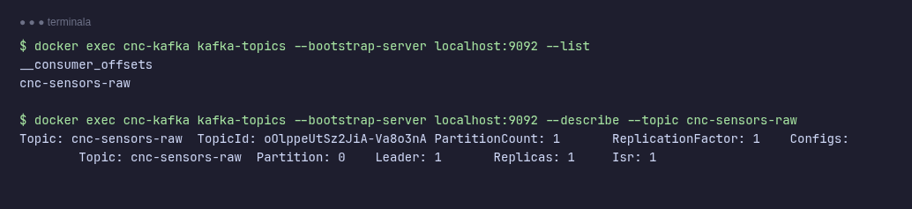
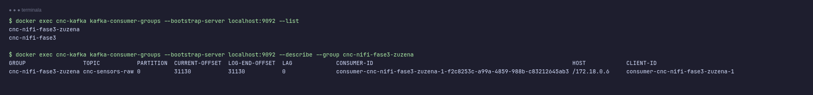
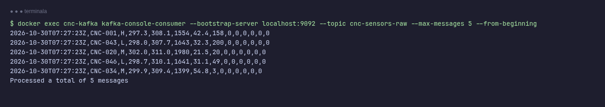

# Kafka dokumentazioa

## 1. Deskribapena

Kafka **CNC Guard** sistemaren mezularitza-bufferra da. Filebeat-ek CSV fitxategietako lerroak
bertara bidaltzen ditu, eta NiFi-k handik kontsumitzen ditu. Bi pieza horien artean dagoenez,
bakoitzak bere erritmoan lan egin dezake: NiFi gelditzen bada, mezuak Kafka-n geratzen dira
eta berrabiaraztean jarraitzen du irakurtzen gelditu zen tokitik.

```text
Filebeat ──► Kafka (cnc-sensors-raw) ──► NiFi ──► ...
```

| Atributua | Balioa |
|---|---|
| Irudia | `confluentinc/cp-kafka:7.5.0` |
| Edukiontziaren izena | `cnc-kafka` |
| Modua | KRaft (ZooKeeper gabe), nodo bakarra: `broker` + `controller` |
| Helbidea (Docker sare barnean) | `kafka:9092` |
| Topikoa | `cnc-sensors-raw` |
| Ataka ostalarian | Ez da argitaratzen: Kafka-ra Docker sare barnetik soilik iristen da |
| Datuen bolumena | `kafka-data` → `/var/lib/kafka/data` |

> Dokumentu honetako balioak martxan dagoen `cnc-kafka` edukiontzitik hartu dira
> (`docker inspect` eta Kafka-ren komandoak). Errepositorioko `docker-compose.yml` ikasleek
> osatu beharreko txantiloia da, eta Kafka-ren zerbitzua hutsik dago.

## 2. Konfigurazioa

Kafka ingurune-aldagaien bidez konfiguratzen da. Hauek dira garrantzitsuenak:

| Aldagaia | Balioa | Zer egiten du |
|---|---|---|
| `KAFKA_PROCESS_ROLES` | `broker,controller` | Nodo berak bi rolak betetzen ditu; horrela ez da ZooKeeper behar. |
| `KAFKA_NODE_ID` | `1` | Nodoaren identifikatzailea. |
| `KAFKA_CONTROLLER_QUORUM_VOTERS` | `1@kafka:9093` | Kontrolatzaileen kuorumaren kide bakarra nodo hau da. |
| `KAFKA_LISTENERS` | `PLAINTEXT://0.0.0.0:9092,CONTROLLER://0.0.0.0:9093` | `9092` bezeroentzat, `9093` kontrolatzailearen barne-komunikaziorako. |
| `KAFKA_ADVERTISED_LISTENERS` | `PLAINTEXT://kafka:9092` | Bezeroei emandako helbidea; Docker sareko `kafka` izenak ebazten du. |
| `KAFKA_AUTO_CREATE_TOPICS_ENABLE` | `true` | Topikoa lehen mezuarekin sortzen da, eskuz sortu gabe. |
| `KAFKA_OFFSETS_TOPIC_REPLICATION_FACTOR` | `1` | Nodo bakarra dagoenez, ezin da erreplikazio handiagorik izan. |
| `KAFKA_TRANSACTION_STATE_LOG_REPLICATION_FACTOR` / `..._MIN_ISR` | `1` / `1` | Arrazoi bera. |
| `KAFKA_LOG_DIRS` | `/var/lib/kafka/data` | Mezuak diskoan non gordetzen diren (`kafka-data` bolumena). |
| `CLUSTER_ID` | (balio finkoa) | KRaft klusterraren IDa; ez aldatu datuak dituen bolumen batekin. |

Segurtasuna: `PLAINTEXT` (autentifikaziorik eta zifraketarik gabe). Ataka ez dago ostalarira
irekita, beraz Docker sareko edukiontziek soilik erabil dezakete.

## 3. Topikoa: `cnc-sensors-raw`

| Propietatea | Balioa |
|---|---|
| Partizioak | 1 |
| Erreplikazio-faktorea | 1 |
| Lider | nodo `1` |
| Produzitzailea | Filebeat (`output.kafka`) |
| Kontsumitzaileak | NiFi-ren bi `ConsumeKafka` (ikus [NiFi dokumentazioa](nifi_dokumentazioa.md)) |

Partizio bakarra denez, mezuen ordena osoa mantentzen da, baina ezin da kontsumo paraleloa
egin talde baten barruan. Datu-bolumen honekin ez da arazo bat.

### 3.1 Mezuaren formatua

Mezu bakoitza CSV fitxategi bateko **lerro gordin bat** da (Filebeat-ek `codec.format` bidez
`message` eremua soilik bidaltzen du, goiburua baztertuta). 14 eremu ditu:

```text
timestamp,machine_id,machine_type,air_temp_K,process_temp_K,rpm,torque_Nm,tool_wear_min,machine_failure,failure_TWF,failure_HDF,failure_PWF,failure_OSF,failure_RNF
```

Adibidea:

```text
2026-10-30T07:27:23Z,CNC-001,H,297.3,308.1,1554,42.4,158,0,0,0,0,0,0
```

Goiburu-lerroa ez da Kafka-ra iristen, beraz NiFi-ko CSV irakurleak ez du goibururik
espero (`Treat First Line as Header = false`) eta zutabeen izenak eskemak ematen ditu.

## 4. Kontsumitzaile-taldeak

NiFi-k bi `ConsumeKafka` erabiltzen ditu, bakoitza bere taldearekin. Horri esker, biek
mezu **guztiak** jasotzen dituzte (taldeen artean offset-ak independenteak dira):

| Talde (`group.id`) | NiFi-ko flow-a | Helburua |
|---|---|---|
| `cnc-nifi-fase3-zuzena` | CNC Guard - Zuzenean | Sentsore-datuak `cnc-sensors` indizera |
| `cnc-nifi-fase3` | CNC Guard - Streaming | Datuak puntuatu eta `cnc-predictions` indizera |

Biek `auto.offset.reset = earliest` dute: talde berri batek topikoaren hasieratik irakurtzen
du. Offset-ak (`Commit Offsets = true`) Kafka-n gordetzen dira.

## 5. Egiaztapenak

Kafka-ren komandoak `cnc-kafka` edukiontzi barruan exekutatzen dira. Komando guztiak
irakurketa soilekoak dira.

### 5.1 Topikoak zerrendatu eta deskribatu

```bash
docker exec cnc-kafka kafka-topics --bootstrap-server localhost:9092 --list
docker exec cnc-kafka kafka-topics --bootstrap-server localhost:9092 --describe --topic cnc-sensors-raw
```



`__consumer_offsets` Kafka-ren barne-topikoa da (taldeen offset-ak gordetzen ditu).
`PartitionCount: 1`, `Leader: 1` eta `Isr: 1` ikusten badira, topikoa osasuntsu dago.

### 5.2 Kontsumitzaile-taldeak eta atzerapena (lag)

```bash
docker exec cnc-kafka kafka-consumer-groups --bootstrap-server localhost:9092 --list
docker exec cnc-kafka kafka-consumer-groups --bootstrap-server localhost:9092 --describe --group cnc-nifi-fase3-zuzena
```



Zutabe garrantzitsuena `LAG` da (`LOG-END-OFFSET` − `CURRENT-OFFSET`): taldeak oraindik
irakurri gabe dituen mezuen kopurua. `0` edo balio txiki bat → NiFi-k erritmoa jarraitzen du.
Etengabe handitzen bada, NiFi geldituta dago edo geroegi doa.

### 5.3 Mezuak ikusi

```bash
docker exec cnc-kafka kafka-console-consumer --bootstrap-server localhost:9092 \
  --topic cnc-sensors-raw --max-messages 5 --from-beginning
```



Mezuak goibururik gabeko CSV lerroak izan behar dira. Kontsola-kontsumitzaileak aldi baterako
talde propioa sortzen du (`console-consumer-...`), beraz ez du NiFi-ren offset-ei eragiten.

Topikoaren mezu-kopurua (azken offset-a):

```bash
docker exec cnc-kafka kafka-run-class kafka.tools.GetOffsetShell \
  --bootstrap-server localhost:9092 --topic cnc-sensors-raw
```

## 6. Arazoak konpontzen

| Sintoma | Arrazoi probablea | Zer egin |
|---|---|---|
| `cnc-sensors-raw` topikoa ez dago | Filebeat-ek ez du mezurik bidali (`auto.create` lehen mezuarekin sortzen du) | Begiratu `docker logs cnc-filebeat` eta CSV-ak `/mnt/cnc-stream/`-en daudela |
| Topikoa dago baina mezurik ez | Filebeat-ek fitxategi guztiak irakurrita ditu (registry) edo goiburua baino ez dago | Ikusi [Filebeat dokumentazioa](filebeat_dokumentazioa.md) |
| `LAG` etengabe handitzen | NiFi-ko `ConsumeKafka` geldituta edo flow-ak blokeatuta (ilara beteta) | Ireki NiFi eta begiratu ilarak eta prozesadoreen egoera |
| NiFi-k `kafka:9092` ez du lortzen | Kafka ez dago `healthy` edo sare desberdinean dago | `docker compose ps` eta `docker logs cnc-kafka` |
| Kafka berrabiarazi ondoren datuak galdu dira | `kafka-data` bolumena ezabatu da (`down -v`) | Bolumena mantendu; ezabatuz gero, Filebeat-en registry-a ere garbitu behar da |
| `Consumer group '...' does not exist` | Taldea oraindik ez da sortu (NiFi ez da inoiz konektatu) | Egiaztatu NiFi-ko `ConsumeKafka` `Running` dagoela eta `Group ID` zuzena dela |

## 7. Erreferentziak

- [Filebeat dokumentazioa](filebeat_dokumentazioa.md): mezuak Kafka-ra nola iristen diren.
- [NiFi dokumentazioa](nifi_dokumentazioa.md): mezuak nola kontsumitzen eta prozesatzen diren.
- [Apache Kafka — dokumentazio ofiziala](https://kafka.apache.org/documentation/)
- [Confluent Platform — Docker irudiak](https://docs.confluent.io/platform/current/installation/docker/config-reference.html)
