# Sistemak eta Big Data: Txosten Tekniko Osoa (Kibana Dokumentazioa)

**Talde A/1**: Naroa Maiztegui, Igor Lizaso, Aritz Echeverria eta Alan Nieto
**Data**: 2026-11-04
**Proiektua**: CNC Guard — Mantentze Prediktiboa eta Datu-Streaming Arkitektura


---

## Aurkibidea

1. [1. Atala: Datu-Arkitektura, Ingesta eta Indizeen Diseinua (IE1, IE3, IE4)](#1-atala-datu-arkitektura-ingesta-eta-indizeen-diseinua-ie1-ie3-ie4)
   - [1.1. Datu-Egitura Integratua (JSON Schema)](#11-datu-egitura-integratua-json-schema)
   - [1.2. Index Template eta Mapping-ak (`arakain_cnc_template`)](#12-index-template-eta-mapping-ak-arakain_cnc_template)
   - [1.3. Ingest Pipeline Automatizatua (`arakain_enrich_pipeline`)](#13-ingest-pipeline-automatizatua-arakain_enrich_pipeline)
2. [2. Atala: Oinarri Algoritmikoak, Konplexutasuna eta Real-Time Erabilera](#2-atala-oinarri-algoritmikoak-konplexutasuna-eta-real-time-erabilera)
   - [2.1. Logika Algoritmikoa eta Konplexutasun Konputazionala](#21-logika-algoritmikoa-eta-konplexutasun-konputazionala)
   - [2.2. Near Real-Time (NRT) Prozesamendua eta Kafka-NiFi Streaming Arkitektura](#22-near-real-time-nrt-prozesamendua-eta-kafka-nifi-streaming-arkitektura)
3. [3. Atala: Kibana Bistaratzea eta Aginte-Koadroa (Dashboard-a)](#3-atala-kibana-bistaratzea-eta-aginte-koadroa-dashboard-a)
   - [DASHBOARD 1: Monitorizazio Orokorra](#dashboard-1-monitorizazio-orokorra)
     - [3.1. Bistaratze-Tekniken Sailkapena eta Justifikazioa](#31-bistaratze-tekniken-sailkapena-eta-justifikazioa)
     - [3.2. Aginte-Koadroaren Garapena eta Erabilera](#32-aginte-koadroaren-garapena-eta-erabilera)
   - [DASHBOARD 2: Kudeaketa Kritikoa eta Alerta Prediktiboak](#dashboard-2-kudeaketa-kritikoa-eta-alerta-prediktiboak)
4. [5. Discover Atala](#5-discover-atala)
5. [6. Atala: Negozio-Inpaktua eta Mantentze-Erabakiak](#6-atala-negozio-inpaktua-eta-mantentze-erabakiak)
   - [6.1. Kostu eta Kalitate Irizpideak](#61-kostu-eta-kalitate-irizpideak)
   - [6.2. Datu-Analisiak Negozioan Duen Eragina (Adibide Operatiboa)](#62-datu-analisiak-negozioan-duen-eragina-adibide-operatiboa)

---

## 1. Atala: Datu-Arkitektura, Ingesta eta Indizeen Diseinua (IE1, IE3, IE4)

### 1.1. Datu-Egitura Integratua (JSON Schema)

Sentsoreetatik Filebeat eta Apache NiFi bidez bildu eta IA ereduaren inferentzia-zerbitzutik (`cnc-scoring` FastAPI) igarotako datu-egitura JSON formatu lau eta optimizatuan prozesatzen da.

Egitura honek telemetria fisikoa (tenperatura, abiadura, higadura) eta aurreikuspen prediktiboa (`failure_probability`, `alert_level`) dokumentu bakarrean integratzen ditu:

```json
{
  "@timestamp": "2026-10-23T09:03:32.000Z",
  "machine_id": "CNC-039",
  "air_temp_k": 298.95,
  "process_temp_k": 308.6,
  "rotational_speed_rpm": 1500,
  "torque_nm": 40.2,
  "tool_wear_min": 145,
  "failure_probability": 0.88,
  "alert_level": "LARRIA",
  "machine_failure": 1
}
```


---

### 1.2. Index Template eta Mapping-ak (`arakain_cnc_template`)

Elasticsearch-en datuak biltegiratu eta azkar kontsultatzeko, `arakain_cnc_template` index template-a sortu da. Mapeo honek eremu bakoitzaren datu-mota egokia bermatzen du:

1. **`keyword`**: Testu-kategoriak (`machine.id`, `machine.line`, `status_alert`), iragazketa eta agregazio azkarrak ahalbidetzeko (term-level queries).
2. **`float` / `integer`**: Neurgailu zenbakizkoak (`temperature_celsius`, `vibration_mm_s`, `failure_probability`), kalkulu matematikoak, mailaketak eta histogramak egiteko.
3. **`date`**: `@timestamp` eremua, denbora-serieen analisia eta denbora-leihoen araberako iragazketa optimizatzeko.

```json
PUT _index_template/arakain_cnc_template
{
  "index_patterns": ["arakain-cnc-telemetry-*"],
  "template": {
    "mappings": {
      "properties": {
        "@timestamp": { "type": "date" },
        "machine": {
          "properties": {
            "id": { "type": "keyword" },
            "line": { "type": "keyword" },
            "model": { "type": "keyword" }
          }
        },
        "telemetry": {
          "properties": {
            "vibration_mm_s": { "type": "float" },
            "temperature_celsius": { "type": "float" },
            "power_consumption_kw": { "type": "float" },
            "spindle_speed_rpm": { "type": "integer" }
          }
        },
        "ai_inference": {
          "properties": {
            "failure_probability": { "type": "float" },
            "predicted_rul_hours": { "type": "float" },
            "anomaly_detected": { "type": "boolean" },
            "status_alert": { "type": "keyword" }
          }
        }
      }
    }
  }
}
```

---

### 1.3. Ingest Pipeline Automatizatua (`arakain_enrich_pipeline`)

Datuak indexatu aurretik Elasticsearch barrunbean aberasteko eta balioztatzeko, `arakain_enrich_pipeline` ingest pipeline-a konfiguratu da. Pipeline honek sarrerako datuen koherentzia eta fidagarritasuna bermatzen du:

1. Ingesta-unearen denbora-marka gordetzen du (`ingest_time`).
2. Painless gidoi bidez, balio kritikoen arabera alerta-egoerak automatikoki eguneratzen ditu giza-interbentziorik gabe.

```json
PUT _ingest/pipeline/arakain_enrich_pipeline
{
  "description": "CNC sentsoreen datuak aberasteko eta balioztatzeko pipelinea",
  "processors": [
    {
      "set": {
        "field": "ingest_time",
        "value": "{{_ingest.timestamp}}"
      }
    },
    {
      "script": {
        "lang": "painless",
        "source": """
if (ctx.telemetry != null && ctx.telemetry.temperature_celsius > 80.0) {
  if (ctx.ai_inference == null) { ctx.ai_inference = [:]; }
  ctx.ai_inference.status_alert = 'CRITICAL';
}
"""
      }
    }
  ]
}
```


---

## 2. Atala: Oinarri Algoritmikoak, Konplexutasuna eta Real-Time Erabilera

### 2.1. Logika Algoritmikoa eta Konplexutasun Konputazionala

50 CNC makinetako sentsore-korronte etengabean kontsulta azkarrak bermatzeko, azpiegiturak bi oinarri algoritmiko nagusi erabiltzen ditu:

- **Inverted Index (Indexazio Alderantzikatua)**: Kategoriak eta egoerak (`alert_level.keyword`, `machine_id.keyword`) bilatzeko konplexutasun konputazionala $\mathcal{O}(1)$ mailan mantentzen du. Termino bakoitzak dagokion dokumentu-zerrenda zuzenean esleitzen du, taula osoa eskaneatu beharrik gabe.
- **BKD Zuhaitzak (KD-Trees)**: Zenbakizko metrikak (`tool_wear_min`, `air_temp_k`, `failure_probability`) eta denborazko serieen eremu-iragazketa (range queries) konplexutasun konputazional $\mathcal{O}(\log N)$ mailan exekutatzea bermatzen du.

### 2.2. Near Real-Time (NRT) Prozesamendua eta Kafka-NiFi Streaming Arkitektura

Datuen jarioak **Near Real-Time (NRT)** prozesamendua betetzen du pauso hauen bidez:

1. **Filebeat**-ek `/mnt/cnc-stream/*.csv` bidetik 30 segundoro sortutako lote fitxategiak detektatzen ditu (inodoen independentziarekin).
2. Datu gordinak **Apache Kafka**-ren `cnc-sensors-raw` topikora igortzen dira berehala.
3. **Apache NiFi**-k mezuak kontsumitu, CSV formatutik JSON formatura eraldatu, `cnc-scoring` FastAPI zerbitzutik igaro azken inferentzia lortzeko, eta Elasticsearch-eko `cnc-predictions` indizera bidaltzen ditu.
4. Sentsoreak neurtzen duenetik Kibanako aginte-koadroan bistaratu arteko atzerapena **segundo batetik beherakoa** da ($\le 1\text{ s}$).

---

## 3. Atala: Kibana Bistaratzea eta Aginte-Koadroa (Dashboard-a)

### DASHBOARD 1: Monitorizazio Orokorra

Aginte-koadro nagusiak lantegiko 50 makinen egoera orokorra bistaratzen du, denbora errealeko KPIak, tenperatura-serieak, higadura-arriskuak eta azken irakurketak zentralizatuz.

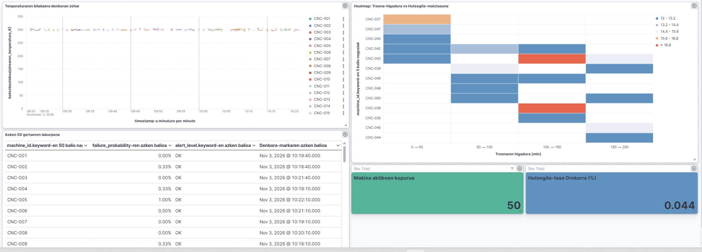

#### 3.1. Bistaratze-Tekniken Sailkapena eta Justifikazioa

| Bisualizazio Mota | Tresna | Datu-Mota | Erabilera eta Helburua |
|---|---|---|---|
| **KPI Metrika Duala** | `Lens Metric` | Agregazio zenbakizkoa | Plantan aktibo dauden makinen kopurua (50) eta hutsegite-tasa orokorra (%4.4) begiratu batean ikusteko. |
| **Denbora-Serieak** | `Lens Line Chart` | Datu jarraituak (Time-Series) | Tenperaturaren bilakaera denboran zehar ikusteko eta anomalia termikoak detektatzeko. |
| **Heatmap Matrizea** | `Lens Heatmap` | Datu kuantitatiboak / Matrizea | Tresnaren higadura (min) eta maiztasuna konparatzeko, arrisku gehien duten makinak gorriz nabarmenduz. |
| **Datu-Taula** | `Lens Data Table` | Erregistroen laburpena | 50 makinen azken egoera, hutsegite-probabilitatea eta alerta-maila zerrendatzeko. |
| **Iragazki Dinamikoak** | `Controls Panel` | Kategoriak (`keyword`) | Makina zehatz bat (`machine_id`) hautatuz aginte-koadro osoa instant batean iragazteko. |

---

#### 3.2. Aginte-Koadroaren Garapena eta Erabilera

##### 1. Tenperaturaren bilakaera denboran zehar (`Lens Line Chart`)
- **Data View**: `cnc-sensors`
- **Konfigurazioa**:
  - X Ardatza: `@timestamp` minuturo.
  - Y Ardatza: `average(airearen_tenperatura_K)`.
  - Breakdown: Top 15 values of `machine_id.keyword`.
- **Erabilera**: Top 15 makinen aire-tenperaturaren (Kelvin) bilakaera denboran zehar ikusteko eta anomalia termikoak berehala detektatzeko.

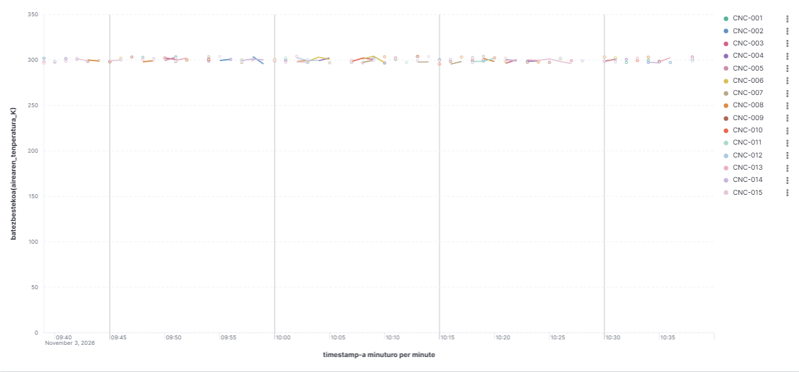

##### 2. Heatmap: Tresna-higadura vs Hutsegite-maiztasuna (`Lens Heatmap`)
- **Data View**: `cnc-sensors`
- **Konfigurazioa**:
  - X Ardatza: Tresnaren higadura minututan tarteka (`0->50`, `50->100`, `100->150`, `150->200`).
  - Y Ardatza: `machine_id.keyword`-en 5 balio nagusiak.
  - Cell value: `Count of records`.
- **Erabilera**: Tresnaren higadura (min) eta gertaeren maiztasuna konparatzeko, arrisku gehien duten makinak kolore gorriz nabarmenduz.

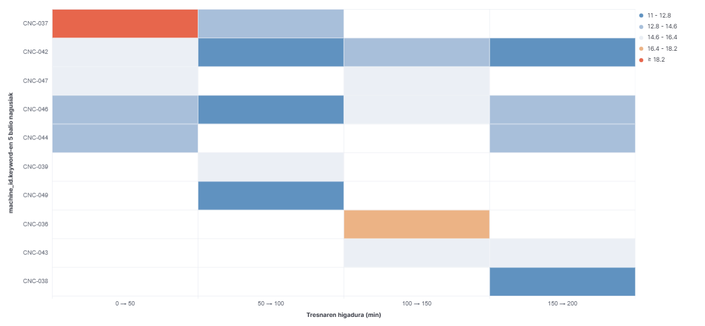

##### 3. Azken 50 gertaeren laburpena (`Lens Data Table`)
- **Data View**: `cnc-predictions`
- **Konfigurazioa**:
  - Rows: `machine_id.keyword`-en 50 balio nagusiak.
  - Metrics: `failure_probability`-ren azken balioa, `alert_level.keyword`-en azken balioa eta Denbora-markaren azken balioa (`Last value of @timestamp`).
- **Erabilera**: 50 makinen azken egoera, hutsegite-probabilitatea eta alerta-maila zerrendatzeko, datu bikoiztuak prebenituz.

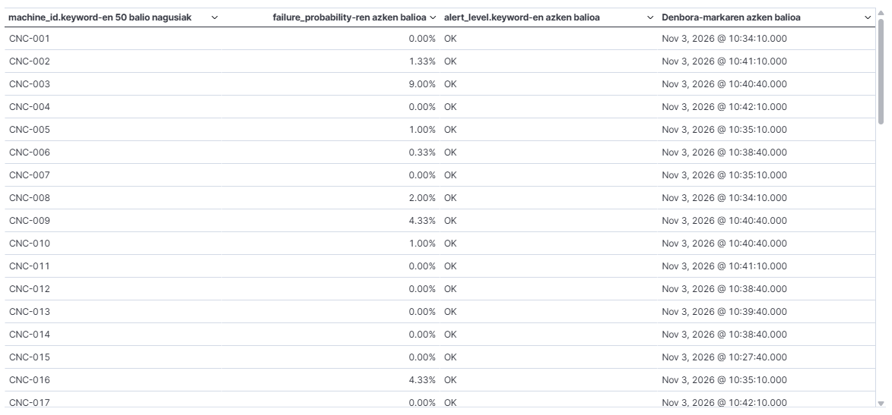

##### 4. Metrika Nagusiak (`Lens Metric KPI Cards`)
- **Data View**: `cnc-sensors` eta `cnc-predictions`
- **Konfigurazioa**:
  - Makina aktiboen kopurua: `Unique count of machine_id.keyword` (50).
  - Hutsegite-tasa Orokorra: `Average of machine_failure` (%3.9 / 0.039).
- **Erabilera**: Plantan aktibo dauden makinen kopurua eta hutsegite-tasa orokorra begiratu batean kontrolatzeko.


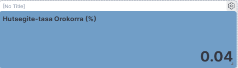

---

### DASHBOARD 2: Kudeaketa Kritikoa eta Alerta Prediktiboak

Bigarren aginte-koadro honek arreta berezia jartzen du egoera larrian dauden makinetan, mantentze-taldeei erabaki azkarrak hartzeko beharrezkoak diren datu analitikoak eskainiz.

##### 1. Hutsegite-probabilitate maximoa une honetan (`Lens Gauge Vertical`)
- **Data View**: `cnc-predictions`
- **Konfigurazioa**:
  - Metric: `Max value of failure_probability` une honetan.
  - Minimum value: 0 | Maximum value: 1 (Balio historiko altuena: %99.70).
  - Atalaseak:
    - **OK**: $< 50\%$ (Berdea)
    - **KONTUZ**: $50\% - 80\%$ (Horia)
    - **LARRIA**: $> 80\%$ (Gorria)
- **Erabilera**: Plantako makina guztien artean azken orduan erregistratutako arrisku handiena bistaratzea, gutxienez makina batek berehalako arriskua duela ohartaraziz.

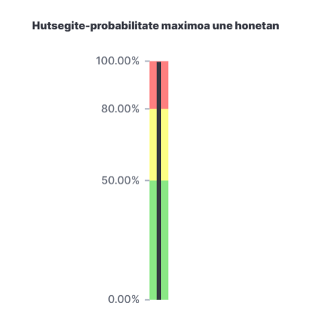

##### 2. LARRIA mailako alertak - Azken ordua (`Lens Data Table`)
- **Data View**: `cnc-predictions`
- **Konfigurazioa**:
  - Rows: Top 10 values of `machine_id.keyword`.
  - Metrics: `Last value of failure_probability` eta `Last value of @timestamp`.
  - Iragazkia (Filter): `alert_level.keyword : "LARRIA"`.
- **Erabilera**: Egoera kritikoan dauden makinen zerrenda zehatza erakustea, arrisku-mailaren arabera beheranzko ordenan kokatuz.

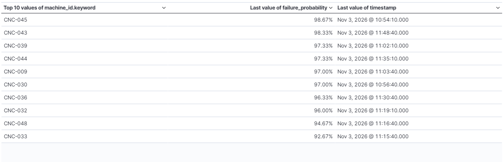

##### 3. Alerta mailen banaketa (`Lens Donut`)
- **Data View**: `cnc-predictions`
- **Konfigurazioa**:
  - Slice by: Top 3 values of `alert_level.keyword` (**OK** %97.33, **LARRIA** %1.75, **KONTUZ** %0.92).
  - Metric: `Count of records`.
- **Erabilera**: Jasotako gertaera guztien ehuneko globala eta alerta-maila bakoitzaren proportzioa modu grafiko argian bistaratzea.

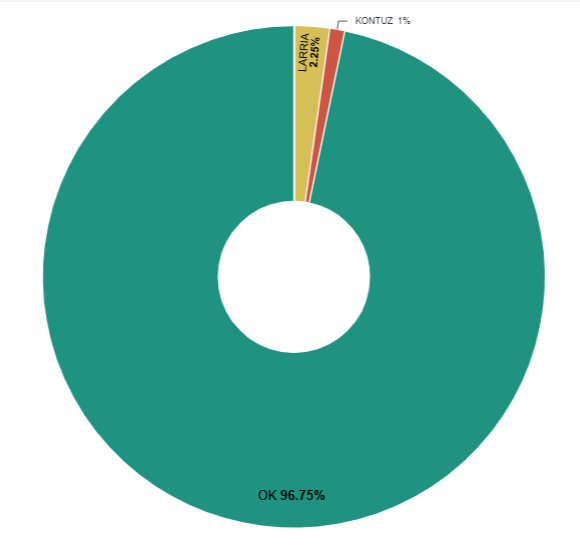

##### 4. LARRIA alerten kopurua (`Lens Metric KPI Card`)
- **Data View**: `cnc-predictions`
- **Konfigurazioa**:
  - Primary metric: `Count of records` non `alert_level.keyword : "LARRIA"`.
- **Erabilera**: Azken orduko leiho tenporalean jaulkitako alerta kritikoen kopuru absolutua (29 alerta) adierazle gorri handi baten bidez azpimarratzea.

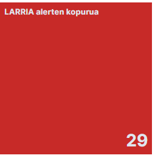

##### 5. Hutsegite-probabilitatearen bilakaera makina bakoitzeko (`Lens Line Chart`)
- **Data View**: `cnc-predictions`
- **Konfigurazioa**:
  - X Ardatza: `@timestamp` minutuko maiztasunarekin.
  - Y Ardatza: `Average of failure_probability`.
  - Breakdown: Top 10 values of `machine_id.keyword`.
  - Reference lines: **KONTUZ** (%50) eta **LARRIA** (%80).
- **Erabilera**: Denboran zehar makina bakoitzaren arriskuaren bilakaera jarraitua irudikatzea eta erreferentzia-lerroen bidez %50 eta %80ko mugak gainditzen dituzten une kritikoak identifikatzea.

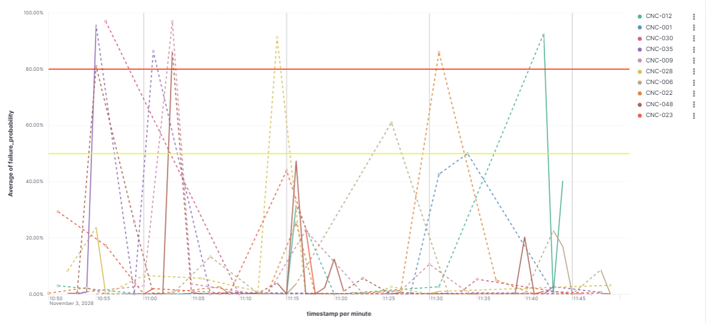

---

## 5. Discover Atala

Kibana-ko **Discover** interfazeak datu gordinen eta inferentzien esplorazio sakona ahalbidetzen du:

- **Data View**: `cnc-predictions`
- **Erabilera**: Sentsoreen erregistro bakoitzaren JSON xehetasunak bilatu, ikuskatu eta iragaz daitezke **KQL** (Kibana Query Language) kontsulten bidez.
- **KQL Adibidea**:
  ```kql
  alert_level.keyword : "LARRIA"
  ```
- **Denbora-Banaketa**: Gertaera kritikoen banaketa tenporala histograma bidez bistaratzen da, anomalia-kontzentrazioak erraz antzemateko.

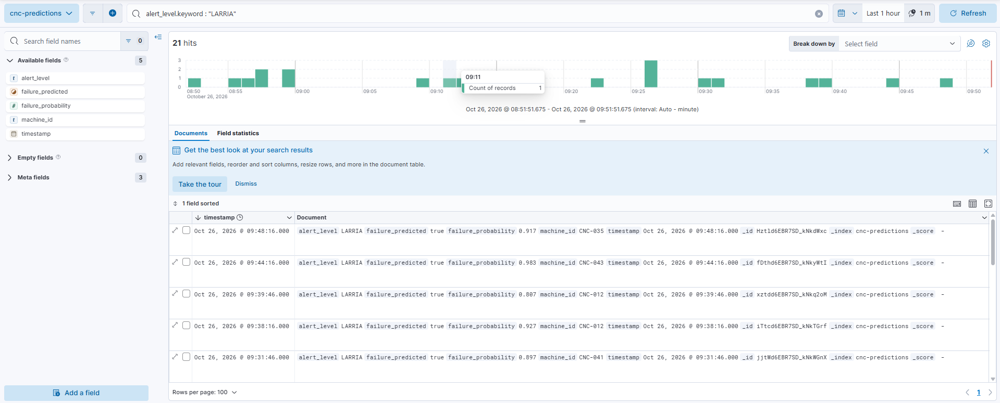

### Dokumentu Hedatua (JSON Egitura)

Erregistro batean klik egitean, dokumentu osoa JSON formatuan azter daiteke, metadatu guztiak (`_index`, `_id`, `_version`, telemetria-eremuak eta inferentzia-probabilitateak) egiaztatuz:

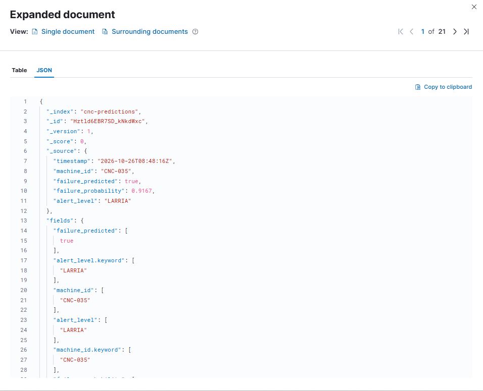

---

## 6. Atala: Negozio-Inpaktua eta Mantentze-Erabakiak

### 6.1. Kostu eta Kalitate Irizpideak

ARAKAIN fabrikazio-lantegian, CNC makina baten ezusteko geldialdiak **1.200 €/orduko** galerak eragiten ditu produkzio-etenaldiengatik eta premiazko baliabideengatik. Big Data eta IA sistemaren ezarpenak enpresaren mantentze-eredua eraldatzen du:

```text
[ KUDEAKETA ERREAKTIBOA ] ──► Hautsi ──► Gelditu ──► 1.200 €/h Galdu (Garestia)
[ KUDEAKETA PREDIKTIBOA ] ──► Anomalia detektatu ──► Geldialdia programatu ──► Galera Ekonomikoa Ekidin
```

---

### 6.2. Datu-Analisiak Negozioan Duen Eragina (Adibide Operatiboa)

Jarraian benetako kasu operatibo baten urratsak deskribatzen dira:

1. **Datu Ingestatua**: `CNC-039` makinaren higadura `tool_wear_min`: **185 minutura** iritsi da eta tenperaturaren igoera (`air_temp_k: 298.95`, `process_temp_k: 308.6`) egonkortu da.
2. **Inferentzia Analisia**: Eredu prediktiboak `failure_probability: 0.88` (%88) eta `alert_level: "LARRIA"` kalkulatzen ditu.
3. **Erabaki Operatiboa**: Mantentze-taldeak txanda-amaieran makina **30 minutuz** gelditzea eta tresna ordezkatzea programatzen du, produkzio-lerroa eten gabe.
4. **Aurrezpen Ekonomikoa**: Biharamuneko **5 orduko ezusteko geldialdia** ekiditen da:
   $$\text{Aurreztutako Kostua} = 5\text{ h} \times 1.200\text{ \euro{}/h} = 6.000\text{ \euro{}}$$
   Tresna berriaren eta mantentze-lan programatuaren kostua kenduta (300 €), **aurrezpen garbia 5.700 €** da esku-hartze bakar batean.

