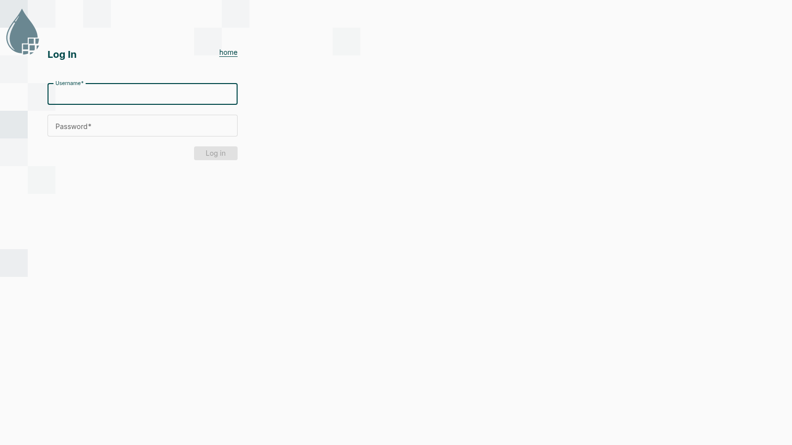
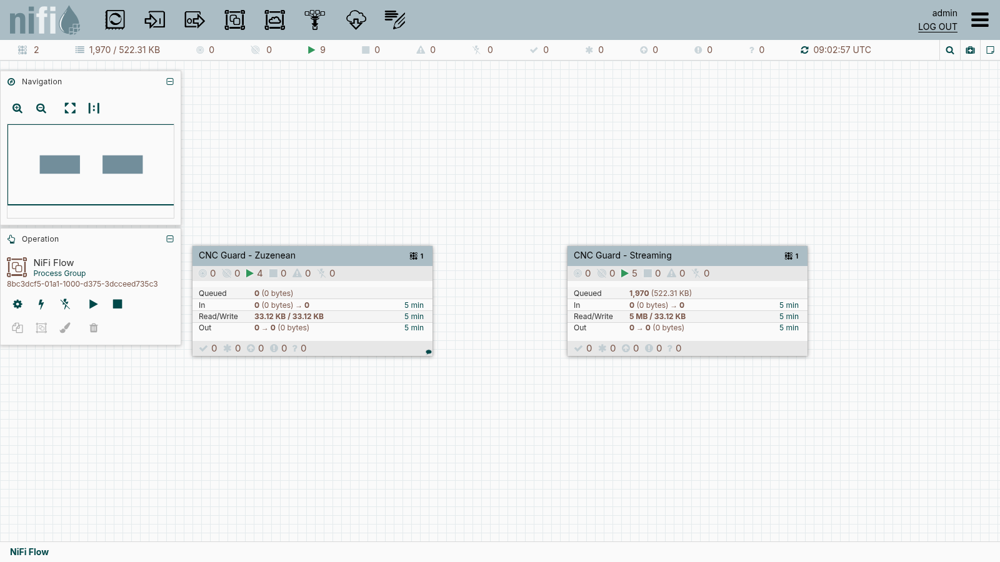
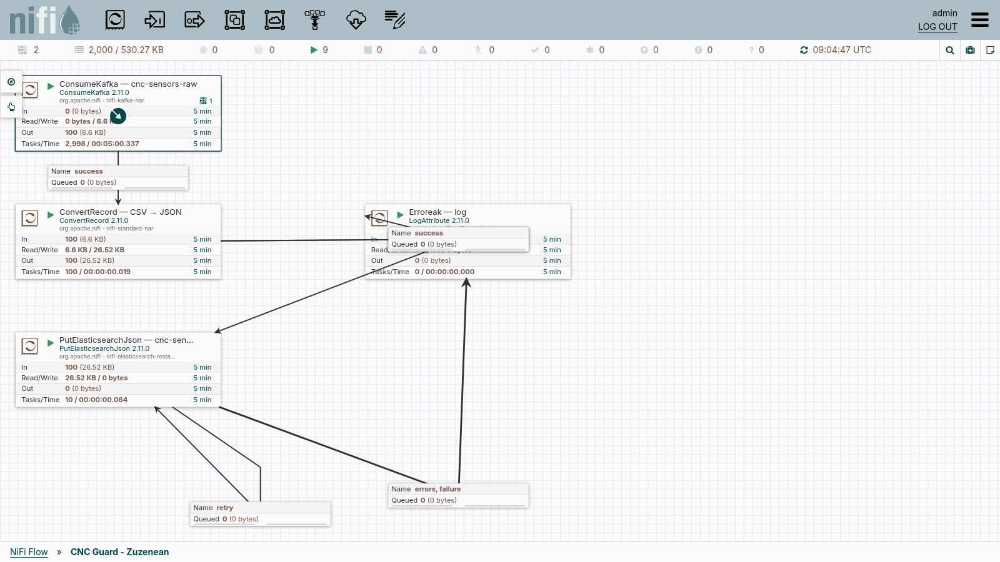
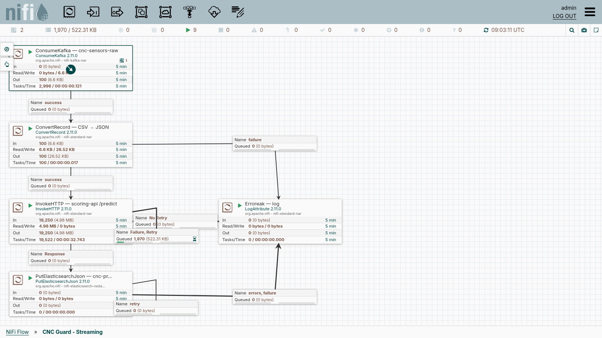
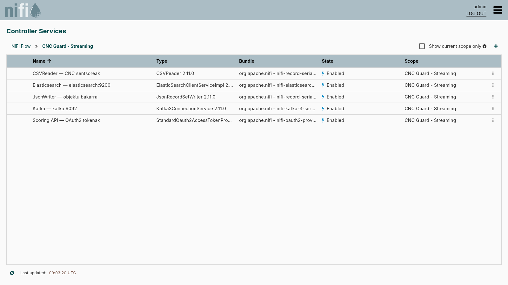
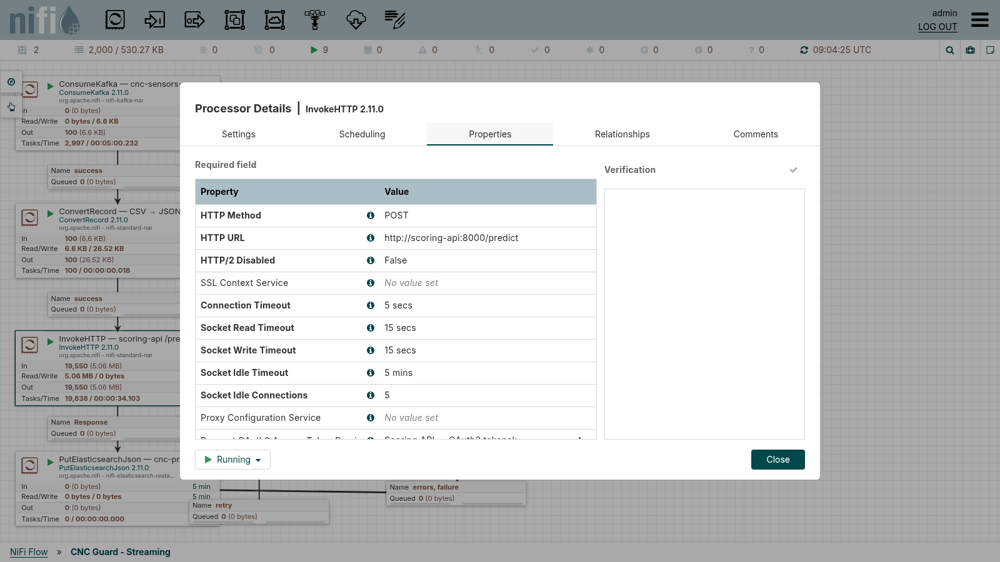
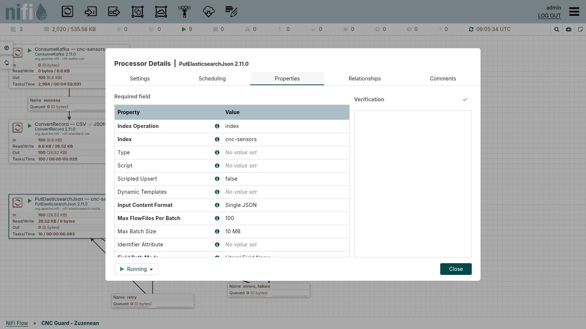

# NiFi dokumentazioa

## 1. Deskribapena

Apache NiFi **CNC Guard** sistemaren transformazio- eta bideratze-geruza da. Kafka-ko
`cnc-sensors-raw` topikoko CSV lerroak kontsumitzen ditu, JSON bihurtzen ditu eta
Elasticsearch-era bidaltzen ditu; bidean, Scoring APIari galdetzen dio gertatzear dagoen
hutsegiteen probabilitatea kalkulatzeko.

```text
Kafka (cnc-sensors-raw) ──► NiFi ─┬─► Elasticsearch  cnc-sensors      (zuzenean)
                                  └─► Scoring API ─► Elasticsearch  cnc-predictions
```

| Atributua | Balioa |
|---|---|
| Irudia | `apache/nifi:2.11.0` |
| Edukiontziaren izena | `cnc-nifi` |
| Web interfazea | `https://localhost:8443/nifi` (ostalaritik soilik: `127.0.0.1:8443`) |
| Autentifikazioa | Erabiltzaile bakarra; kredentzialak `.env` fitxategian (`NIFI_USERNAME`, `NIFI_PASSWORD`) |
| Sarrera | Kafka, `kafka:9092`, `cnc-sensors-raw` topikoa |
| Irteerak | Elasticsearch (`cnc-sensors`, `cnc-predictions`) |

> Dokumentu honetako flow-ak martxan dagoen NiFi-tik hartu dira (REST APIa eta interfazea).
> `nifi-flows/cnc_fase1_INCOMPLETO.json` ikasleek osatu beharreko txantiloia da, eta ez
> du flow osoa ordezkatzen.

Autentifikazioa: NiFi HTTPS bidez dabil, ziurtagiri autosinatuarekin; nabigatzaileak
abisua erakutsiko du eta onartu egin behar da.

## 2. Sarbidea

1. Ireki `https://localhost:8443/nifi` eta onartu ziurtagiriaren abisua.
2. Sartu `.env`-ko erabiltzailea eta pasahitza.



Saioa hasi ondoren, canvas nagusian (*root*) bi prozesu-talde (*process group*) ageri dira:



| Prozesu-taldea | Prozesadoreak | Helburua |
|---|---|---|
| `CNC Guard - Zuzenean` | 4 | Sentsore-datuak `cnc-sensors` indizera |
| `CNC Guard - Streaming` | 5 | Datuak puntuatu eta `cnc-predictions` indizera |

Goiko barrako kontagailuek (`▶ 9`) martxan dauden prozesadoreen kopurua erakusten dute.

## 3. Flow-ak

### 3.1 `CNC Guard - Zuzenean`

Sentsore-datuak aldatu gabe gordetzen ditu, JSON formatura bihurtuta.



| Prozesadorea | Mota | Zer egiten du |
|---|---|---|
| `ConsumeKafka — cnc-sensors-raw` | `ConsumeKafka` | Mezuak irakurtzen ditu (`Group ID = cnc-nifi-fase3-zuzena`, `earliest`). |
| `ConvertRecord — CSV → JSON` | `ConvertRecord` | CSV lerroa JSON erregistro bihurtzen du. |
| `PutElasticsearchJson — cnc-sensors` | `PutElasticsearchJson` | Erregistroa `cnc-sensors` indizean gordetzen du (`index`, 100 FlowFile/batch). |
| `Erroreak — log` | `LogAttribute` | Akatsak `warn` mailan erregistratzen ditu. |

Konexioak:

| Nondik | Nora | Erlazioa |
|---|---|---|
| ConsumeKafka | ConvertRecord | `success` |
| ConvertRecord | PutElasticsearchJson | `success` |
| ConvertRecord | Erroreak — log | `failure` |
| PutElasticsearchJson | Erroreak — log | `errors`, `failure` |
| PutElasticsearchJson | PutElasticsearchJson (bere buruari) | `retry` |

### 3.2 `CNC Guard - Streaming`

Datuak Scoring APIra bidaltzen ditu eta erantzuna (iragarpena) gordetzen du.



| Prozesadorea | Mota | Zer egiten du |
|---|---|---|
| `ConsumeKafka — cnc-sensors-raw` | `ConsumeKafka` | Mezuak irakurtzen ditu (`Group ID = cnc-nifi-fase3`, `earliest`). |
| `ConvertRecord — CSV → JSON` | `ConvertRecord` | CSV → JSON. |
| `InvokeHTTP — scoring-api /predict` | `InvokeHTTP` | `POST http://scoring-api:8000/predict` (`application/json`), OAuth2 tokenarekin. |
| `PutElasticsearchJson — cnc-predictions` | `PutElasticsearchJson` | Scoring APIaren erantzuna `cnc-predictions` indizean gordetzen du. |
| `Erroreak — log` | `LogAttribute` | Akatsak `warn` mailan erregistratzen ditu. |

Konexioak:

| Nondik | Nora | Erlazioa |
|---|---|---|
| ConsumeKafka | ConvertRecord | `success` |
| ConvertRecord | InvokeHTTP | `success` |
| ConvertRecord | Erroreak — log | `failure` |
| InvokeHTTP | PutElasticsearchJson | `Response` |
| InvokeHTTP | InvokeHTTP (bere buruari) | `Failure`, `Retry` |
| InvokeHTTP | Erroreak — log | `No Retry` |
| PutElasticsearchJson | Erroreak — log | `errors`, `failure` |
| PutElasticsearchJson | PutElasticsearchJson (bere buruari) | `retry` |

Kontuan izan: `InvokeHTTP`-ren `Failure` eta `Retry` erlazioak bere buruari itzultzen dira.
Beraz, Scoring APIak akatsa ematen badu, FlowFile-ak ilaran pilatzen dira eta saiakera
errepikatzen da, galdu gabe (ikus [6. atala](#6-arazoak-konpontzen)).

## 4. Controller Service-ak

Prozesadoreek partekatzen dituzten konexioak eta konfigurazioak *Controller Service*
gisa definituta daude, eta `Enabled` egon behar dute. Hamburger menua → *Controller
Services*, edo prozesu-taldearen gainean eskuineko botoia → *Controller Services*.



| Service | Mota | Konfigurazio nagusia |
|---|---|---|
| `Kafka — kafka:9092` | `Kafka3ConnectionService` | `bootstrap.servers = kafka:9092`, `PLAINTEXT` |
| `CSVReader — CNC sentsoreak` | `CSVReader` | Eskema eskuz definitua (`schema-text-property`), `Treat First Line as Header = false`, `,` bereizlea |
| `JsonWriter — objektu bakarra` | `JsonRecordSetWriter` | Erregistro bakoitza JSON objektu bakar gisa (`Pretty Print = false`) |
| `Elasticsearch — elasticsearch:9200` | `ElasticSearchClientServiceImpl` | `http://elasticsearch:9200`, autentifikaziorik gabe |
| `Scoring API — OAuth2 tokenak` | `StandardOauth2AccessTokenProvider` | `http://scoring-api:8000/auth/token`, `Grant Type = password`, erabiltzailea `nifi` |

`Zuzenean` taldeak Kafka, CSVReader, JsonWriter eta Elasticsearch service-en bere kopiak
ditu; OAuth2 tokena `Streaming` taldean bakarrik erabiltzen da.

### 4.1 CSV eskema

`CSVReader`-ek 14 eremuko eskema erabiltzen du (goiburua ez dago mezuan, ikus
[Kafka dokumentazioa](kafka_dokumentazioa.md#31-mezuaren-formatua)):

| Eremua | Mota |
|---|---|
| `timestamp`, `machine_id`, `machine_type` | `string` |
| `air_temp_K`, `process_temp_K`, `rpm`, `torque_Nm`, `tool_wear_min` | `double` |
| `machine_failure`, `failure_TWF`, `failure_HDF`, `failure_PWF`, `failure_OSF`, `failure_RNF` | `int` |

## 5. Prozesadoreen konfigurazioa

Prozesadore baten konfigurazioa ikusteko: bi aldiz klik egin prozesadorean → *Properties*
fitxa.

### 5.1 `InvokeHTTP`



| Propietatea | Balioa |
|---|---|
| `HTTP Method` | `POST` |
| `HTTP URL` | `http://scoring-api:8000/predict` |
| `Request Content-Type` | `application/json` |
| `Connection Timeout` / `Socket Read Timeout` | 5 s / 15 s |
| `Request OAuth2 Access Token Provider` | `Scoring API — OAuth2 tokenak` |

### 5.2 `PutElasticsearchJson`



| Propietatea | Balioa (`Zuzenean`) | Balioa (`Streaming`) |
|---|---|---|
| `Index Operation` | `index` | `index` |
| `Index` | `cnc-sensors` | `cnc-predictions` |
| `Input Content Format` | `Single JSON` | `Single JSON` |
| `Max FlowFiles Per Batch` | `100` | `100` |

## 6. Arazoak konpontzen

### Une honetako egoera (dokumentazioa egin zen unean)

Ikus daiteke `Streaming` flow-ean `InvokeHTTP`-ren `Failure, Retry` konexioan
**ilarak 2.000 FlowFile inguru** dituela, eta `PutElasticsearchJson — cnc-predictions`-era ez
dela ezer iristen (`In = 0`). Arrazoia: Scoring APIak `503 Service Unavailable` itzultzen
du `/predict` deietan, eta `GET /health` erantzunak `"model_loaded": false` dio, hau da,
`models/cnc_failure_model.pkl` modeloa ez dago kargatuta. Konponbidea modeloa jartzea
da (ikusi proiektuaren `README.md`, *Eredua berriro entrenatu* atala); modeloa
kargatzean ilara hustuko da. `Zuzenean` flow-a ez da horrek eragindakoa.

### Sintoma azkarren taula

| Sintoma | Arrazoi probablea | Zer egin |
|---|---|---|
| Ezin da `https://localhost:8443` ireki | NiFi hasten ari da (minutu batzuk behar ditu) edo ataka ez dago argitaratuta | `docker logs cnc-nifi` eta itxaron `NiFi has started` agertu arte |
| Saio-hasierak huts egiten du | Pasahitza ez dator `.env`-rekin bat, edo `.env` aldatu da edukiontzia sortu ondoren | Berrikusi `.env`; `docker compose up -d --force-recreate nifi` |
| `ConsumeKafka`-k ez du ezer irakurtzen | Kafka hutsik dago, edo taldeak dagoeneko dena irakurri du | Begiratu `LAG` ([Kafka dokumentazioa](kafka_dokumentazioa.md#52-kontsumitzaile-taldeak-eta-atzerapena-lag)) |
| Prozesadore bat ⚠ ikonoarekin | Propietate falta da edo Controller Service-a ez dago `Enabled` | Prozesadorean sagua gainean jarri; *Controller Services* → `Enable` |
| Ilara bat pilatzen da | Hurrengo prozesadorea geldituta dago edo kanpoko zerbitzuak huts egiten du | Ireki ilara (*List queue*) eta begiratu FlowFile baten atributuak; `docker logs` kanpoko zerbitzuarena |
| `cnc-sensors` hutsik dago Kibana-n | `Zuzenean` flow-ak huts egiten du (`Erroreak — log`-en mezuak) | `docker exec cnc-nifi tail -f /opt/nifi/nifi-current/logs/nifi-app.log` |
| `cnc-predictions` hutsik, `cnc-sensors` ez | `Streaming` flow-a blokeatuta: ikus Scoring API | `curl localhost:8000/health` |

## 7. Eguneratzeak eta kopiak

- Flow bat esportatzeko: prozesu-taldearen gainean eskuineko botoia → *Download flow
  definition* → `.json` fitxategia (`nifi-flows/` karpetan gorde daiteke).
- Inportatzeko: canvas-eko *Process Group* ikonoa arrastatu → *Browse* → `.json`
  hautatu.
- NiFi-ren egoera bolumenetan gordetzen da; edukiontzia berrabiaraztean flow-ak mantentzen
  dira. `docker compose down -v` exekutatuz gero, **flow guztiak galtzen dira**: esportatu
  aurretik.

## 8. Erreferentziak

- [Kafka dokumentazioa](kafka_dokumentazioa.md): NiFi-k kontsumitzen duen topikoa.
- [Filebeat dokumentazioa](filebeat_dokumentazioa.md): datuak Kafka-ra nola iristen diren.
- [Apache NiFi — dokumentazio ofiziala](https://nifi.apache.org/documentation/)
